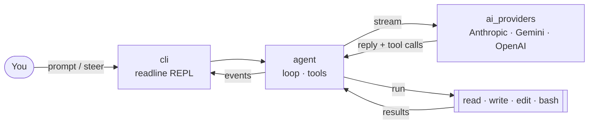

<div align="center">

# 🛠️ coding-harness

**A small, hackable AI coding agent for your terminal.**

Give it a task in plain English, and it reads, writes, edits files and runs shell commands in your project until the job is done.

[](https://nodejs.org)
[](https://www.typescriptlang.org)
[](#-supported-providers)
[](#-supported-providers)
[](#-supported-providers)

[Quick start](#-quick-start) •
[Usage](#-usage) •
[Commands](#-in-session-commands) •
[How it works](#-how-it-works) •
[Development](#-development)

</div>

---

## ✨ What is this?

`coding-harness` is a coding agent built from scratch: an LLM in a loop with four tools.

```text
you ──▶ "add input validation to signup.ts and run the tests"
          │
          ▼
   ┌───────────────┐   tool calls    ┌──────────────────────────┐
   │   LLM (Claude │ ──────────────▶ │ read · write · edit · bash│
   │ Gemini / GPT) │ ◀────────────── │   (in your project dir)   │
   └───────────────┘   tool results  └──────────────────────────┘
          │
          ▼
       answer ✅
```

| Feature | |
|---|---|
| 🧰 **Four tools** | `read`, `write`, `edit`, `bash`, all scoped to the directory you start it in |
| 🔀 **Multiple providers** | Anthropic, Google Gemini and OpenAI |
| 🧭 **Steering** | Type while the agent works to redirect it without stopping it |
| 📄 **Project context** | Reads `AGENTS.md` / `CLAUDE.md` from your project and puts them in the system prompt |
| 🔑 **Key management** | `/login` stores API keys locally; environment variables work too |
| 📦 **Small and readable** | Three packages, plain TypeScript, no framework |

---

## 🚀 Quick start

> **Requirements:** [Node.js](https://nodejs.org) **20+**, `git`, and an API key for at least one provider.
> On **Windows**, install [Git for Windows](https://git-scm.com/download/win): the `bash` tool runs through Git Bash.

### 1. Clone

```bash
git clone https://github.com/devxAT/coding_harness.git
cd coding_harness
```

### 2. Install dependencies

```bash
npm install
```

### 3. Build

```bash
npm run build
```

This compiles the three packages in order (`ai_providers` → `agent` → `cli`) into their `dist/` folders.

### 4. Run

```bash
node packages/cli/dist/main.js
```

Then, inside the session:

```text
/login            # pick a provider and paste your API key
/models           # pick a model with the arrow keys
explain what this project does
```

That's it. 🎉

<details>
<summary><b>💡 Optional: install the <code>coding-harness</code> command globally</b></summary>

<br>

```bash
cd packages/cli
npm link
```

Now you can run it from any project:

```bash
cd ~/my-other-project
coding-harness
```

To remove it later: `npm unlink -g @coding-harness/cli`.

</details>

<details>
<summary><b>🔑 Optional: use environment variables instead of <code>/login</code></b></summary>

<br>

Keys saved with `/login` take priority. When none is saved, these variables are used (a `.env` file in the current directory also works):

| Provider | Variable |
|---|---|
| Anthropic | `ANTHROPIC_API_KEY` |
| Google Gemini | `GEMINI_API_KEY` |
| OpenAI | `OPENAI_API_KEY` |

```bash
# macOS / Linux / Git Bash
export ANTHROPIC_API_KEY=sk-ant-...

# PowerShell
$env:ANTHROPIC_API_KEY = "sk-ant-..."
```

Saved keys live in `~/.coding-harness/auth.json`. Set `CODING_HARNESS_DIR` to store them elsewhere.

</details>

---

## 🎮 Usage

```text
coding-harness [options] [prompt]
```

| Option | Description |
|---|---|
| `prompt` | First message; the session stays open afterwards |
| `-m, --model <id>` | Model to use, e.g. `anthropic/claude-sonnet-5-5` or just `claude-sonnet-5-5` |
| `-p, --print` | Run the prompt, print the answer, and exit (needs `--model`) |
| `-h, --help` | Show help |

<details open>
<summary><b>📚 Examples</b></summary>

<br>

**Interactive session**

```bash
node packages/cli/dist/main.js
```

**Start with a model and a task**

```bash
node packages/cli/dist/main.js -m anthropic/claude-sonnet-5-5 "find and fix the failing test"
```

**One-shot (scripts, CI)**

```bash
node packages/cli/dist/main.js -p -m google/gemini-3.6-flash "summarize the git log of the last week"
```

</details>

---

## ⌨️ In-session commands

| Command | What it does |
|---|---|
| `<text>` | Send a message. **While the agent is running, it steers the agent instead** |
| `/models` | Browse and pick a model (type to filter, arrows to move, Enter to select) |
| `/model <id>` | Pick a model by id |
| `/login [provider]` | Save an API key |
| `/logout [provider]` | Remove a saved API key |
| `/reset` | Clear the conversation |
| `/exit` | Quit |
| `Ctrl+C` | Abort the current run; press again to exit |

> ⚠️ No model is selected at startup. Pass `--model` or use `/models`.
> Only models whose provider has an API key show up in the picker.

---

## 🤖 Supported providers

<details>
<summary><b>Anthropic</b></summary>

`claude-fable-5-1` · `claude-opus-5-5` · `claude-sonnet-5-5` · `claude-haiku-5-5` · `claude-haiku-4-5-20251001`

</details>

<details>
<summary><b>Google Gemini</b></summary>

`gemini-3.8-flash` · `gemini-3.6-flash` · `gemini-3.5-flash-lite`

</details>

<details>
<summary><b>OpenAI</b></summary>

`gpt-6-sol` · `gpt-5-2025-08-07` · `gpt-4o-mini-2024-07-18`

</details>

The model table lives in [packages/ai_providers/src/models/](packages/ai_providers/src/models/).

---

## 🧠 How it works



1. Your message is added to the conversation and sent to the model with the tool definitions.
2. The model replies, possibly with tool calls.
3. Each tool call runs in order inside your project; errors are sent back to the model as tool results, so it can recover.
4. Steps 2–3 repeat until the model answers without tool calls.

<details>
<summary><b>📁 Project layout</b></summary>

<br>

```text
packages/
├── ai_providers/   @coding-harness/ai-providers   LLM layer: streaming, models, cost, validation
├── agent/          @coding-harness/agent          agent loop, Agent class, tools, system prompt
└── cli/            @coding-harness/cli            terminal frontend (binary: coding-harness)
```

Dependencies go one way: `cli → agent → ai_providers`.
Packages import each other through each package's `dist/`, so **rebuild after changing a lower package**.

</details>

---

## 🧑‍💻 Development

| Command | Purpose |
|---|---|
| `npm run build` | Build all packages (needed before running or testing) |
| `npm run check` | Typecheck everything |
| `npm test --workspace @coding-harness/cli` | End-to-end tests (scripted provider, no network or API key needed) |
| `npm run clean` | Delete build output |

A typical loop:

```bash
# edit code...
npm run check
npm run build
npm test --workspace @coding-harness/cli
node packages/cli/dist/main.js
```

See [AGENTS.md](AGENTS.md) for architecture details, conventions and known gaps.

---

## 🗺️ Status

- ✅ Provider layer, agent loop, tools, system prompt, CLI
- ⏳ **Session persistence:** not implemented yet. The conversation is kept in memory only, so quitting loses it
- ⏳ Extended thinking is not enabled yet


